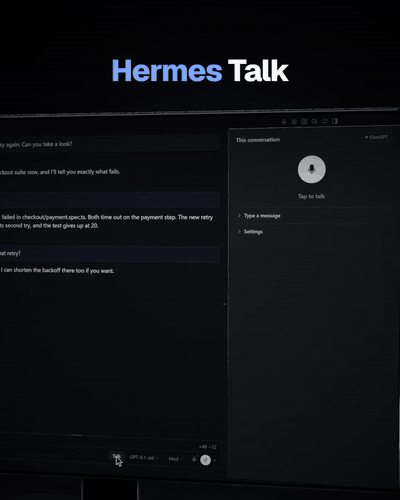

# Hermes Talk

**Realtime voice for Hermes Agent. Press Talk, say what you need, and cut in whenever you like. Your agent keeps using its real tools while you talk.**

<p>
  <a href="https://github.com/TheSmokeDev/hermes-talk/actions/workflows/ci.yml"></a>
  <a href="https://github.com/TheSmokeDev/hermes-talk/actions/workflows/codeql.yml"></a>
  <a href="https://scorecard.dev/viewer/?uri=github.com/TheSmokeDev/hermes-talk"></a>
  <a href="https://pypi.org/project/hermes-talk/"></a>
  <a href="https://pypi.org/project/hermes-talk/"></a>
  <a href="LICENSE"></a>
</p>

Hermes Talk is a plugin for [Hermes Agent](https://github.com/NousResearch/hermes-agent)
that turns it into something you can talk to. You speak, it answers out loud, and
you can interrupt it mid-sentence. While you talk it calls the agent's own tools,
hands longer jobs to background agents, and tells you how they went when they finish.

It runs in the terminal (`hermes talk`), in a Discord voice channel (`/talk join`),
in the Hermes dashboard **Talk** tab, and in [Hermes Desktop](docs/DESKTOP.md).

**No extra API bill on the main lanes.** OpenAI Realtime runs on the ChatGPT
subscription you already have (sign in once with `codex login`), and Grok Voice
runs on your X Premium or SuperGrok login. Gemini Live uses a free AI Studio key
(`GEMINI_API_KEY`). The `local` lane runs on your own model server with no key at all.
Prefer API keys? Those work too.

Hermes Talk adds duplex voice to a Hermes install you already run. It is not a
standalone assistant, and it doesn't replace Hermes's built-in turn-based voice
mode, which is a different (and good) design.

<p align="center"></p>

[**Watch the 0.24 film**](https://github.com/TheSmokeDev/hermes-talk/releases/download/v0.24.1/hermes-talk-0.24-film.mp4) (1:40, with sound): the one-button
panel, switching coding chats by voice, Phone mode, Discord, Echo and the community
behind it. Narration and sample conversations are for demonstration; the features are real.

The original [dashboard demo](docs/dashboard.gif) is a real Realtime session recorded at v0.3.0.

## New in 0.25.0

In an unbound OpenAI Realtime call in Hermes Desktop, say **“slash”** to browse
the active session's workflows. Say **“run the slash meeting action items command”**
to invoke that skill if it is installed. You can also ask which Hermes plugins
are available. A real microphone test on a Codex subscription was confirmed by
the operator. [Voice commands and supported surfaces](docs/VOICE-COMMANDS.md#finding-a-hermes-workflow-by-voice)

## New in 0.24.0

A big community release. The community features in the new Experimental
section ship switched off, so the Talk button you know works exactly as before.

- **One-button Talk.** Desktop and the dashboard Talk tab now open on one large
  voice button with a short status line. Pressing it starts Talk in one step,
  exactly as before. Mute and Sleep show up beside it while you're connected.
  Typing, recipients and attachments sit under **Type a message**, and voice and
  conversation choices live under **Settings**.
- **Experimental settings.** A new Experimental section in the Hermes Talk
  plugin settings holds a saved Amazon Echo, a text-only call journal, voice
  language and a speaker echo hold for speakers with output lag, like a TV over HDMI. Echo and
  the journal start off, language starts on Auto, and the echo hold starts at 0.
  Details: [Experimental plugin settings](docs/OPERATING.md#experimental-plugin-settings).
- **Switch chats by voice.** On a compatible Hermes host you can say "Switch to
  my Codex chat and read its last reply", then "Ask it to check mobile too."
  It works with Claude Code chats as well. If several chats match, Talk asks
  which one you mean. Host requirements and the full phrase list are in
  [recipient-routing.md](docs/recipient-routing.md).
- **Twilio phone server (experimental).** `python -m talk_twilio_server` answers
  calls to your own Twilio number with a fresh Gemini Live session that has no
  task and no tools. Webhooks are signature-checked, callers must be on an
  allowlist, and normal Talk never loads it. It hasn't been confirmed on a real
  call yet. See [TWILIO.md](docs/TWILIO.md).
- **Profile isolation.** On a multiplexed gateway, Talk settings and keys come
  from the profile serving the turn, Discord voice uses that profile's own bot,
  and background work keeps the profile that started it.
- **Discord playback and honest outcomes.** Replies stop cleanly at their
  boundaries and queued announcements resume after playback drains. A run that
  failed, was stopped or was interrupted is now announced as exactly that.
  Delegated work also stops filling the call with empty "still working" lines.
- **Fixes people asked for.** The end-of-call transcript review no longer
  re-spawns itself. Gemini Live no longer fails to start with close code 1007
  on tool schemas. `hermes talk doctor` no longer crashes on a host with no
  audio system.
- **One sign-in for the dashboard.** When the dashboard's own sign-in is on,
  that sign-in opens the Talk tab, with nothing to paste per browser tab. An
  explicit `TALK_DASHBOARD_TOKEN` still protects deployments that set one.

Still fresh from 0.23: an optional [Phone mode](#optional-native-phone-mode)
powered by Dograh, and `TALK_PROVIDER=local` for running the voice lane on your
own GPU ([LOCAL.md](docs/LOCAL.md)). From 0.22: start, check and steer Desktop
sessions by voice ([DESKTOP.md](docs/DESKTOP.md)).

Every version and what it shipped: [CHANGELOG.md](CHANGELOG.md).

## Install

Use the pinned plugin install or upgrade command in the
[0.25.0 release notes](https://github.com/TheSmokeDev/hermes-talk/releases/tag/v0.25.0).
For Python microphone and speaker support, run `pip install "hermes-talk[audio]==0.25.0"`.

You need Python 3.11 or newer and a Hermes host at v0.23.0 or newer. GPT-Live,
shared task attachment and Codex workers need extra host capabilities, listed
in [Prerequisites](docs/OPERATING.md#prerequisites).

Restart the gateway, the dashboard and Desktop afterwards. A running process
keeps the old code until you do. An unpinned Git install can use
`hermes plugins update hermes-talk`.

**Using Desktop?** Installed agent packages are opt-in there. In Desktop
**Capabilities → Plugins**, turn on the Desktop half of **Hermes Talk** if it is
off. Installing the Python wheel alone doesn't register it; the plugin installer
does. More in the [Desktop guide](docs/DESKTOP.md#open-talk).

## Quickstart

**Terminal.** Start here:

```bash
hermes talk
```

Speak, and it answers out loud. Ctrl+C hangs up. More in [Use](docs/OPERATING.md#use).

**Discord.** The call happens in a voice channel, not in chat:

```
/voice join     # put Hermes in the voice channel first
/talk join      # Talk borrows that connection; it never opens a second one
```

Everyone in the room hears the answers, and `/talk leave` ends the call.
Tools that change things stay denied until you set
`TALK_DISCORD_OPERATOR_USER_IDS`. See
[Discord voice](docs/OPERATING.md#discord-voice--talking-in-the-channel-hermes-is-already-in).

Opt-in on hosts with plugin message submission: [same-chat delegated voice](docs/delegated-discord.md)
(`/talk delegate join`) keeps the voice call responsive while Hermes works in that text chat.

**Dashboard.** Browser audio, no local mic drivers:

```bash
hermes dashboard    # then open the Talk tab and press the voice button
```

Allow the microphone and talk. You get the live transcript and a list of
background runs. See [Dashboard tab](docs/OPERATING.md#dashboard-tab).

**Desktop.** Open a conversation, click **Talk** in the top bar or beside the
composer, then press **Start talking**. The popover closes once you're connected
and the audio keeps running; **Stop** stays beside the composer. On stock
Desktop, send one message first so the conversation exists. See
[DESKTOP.md](docs/DESKTOP.md).

## Providers and billing

| Lane | How it authenticates | Default model | Surfaces |
|---|---|---|---|
| OpenAI Realtime (`TALK_PROVIDER=openai`, default) | ChatGPT subscription through `codex login`, or `TALK_OPENAI_API_KEY` / `OPENAI_API_KEY` | `gpt-realtime-2.1` | every surface |
| GPT-Live (`TALK_VOICE_MODE=live`) | `TALK_LIVE_AUTH=subscription` (the default, on the Codex subscription) or explicitly chosen `api` billing; no automatic paid fallback | `gpt-live-1-codex` (subscription) / `gpt-live-1` (API) | terminal, Discord, dashboard, Desktop, on an explicit task |
| xAI Grok Voice (`TALK_PROVIDER=grok`) | an X Premium or SuperGrok login (`hermes auth add xai-oauth`), **no API key**, or `TALK_XAI_API_KEY` / `XAI_API_KEY` | `grok-voice-latest` | terminal + Discord |
| Gemini Live (`TALK_PROVIDER=gemini`) | `GEMINI_API_KEY` / `TALK_GEMINI_API_KEY`; free-tier AI Studio keys work | `gemini-3.1-flash-live-preview` | terminal; Discord refuses it for now |
| Local models (`TALK_PROVIDER=local`) | none by default; any self-hosted OpenAI-Realtime-compatible server, e.g. [speech-to-speech](https://github.com/huggingface/speech-to-speech) with an Ollama LLM | the server's own | terminal (Discord not yet verified) |
| Cascade voice (`TALK_VOICE_MODE=cascade`) | `TALK_ELEVENLABS_API_KEY` / `ELEVENLABS_API_KEY`, on top of the OpenAI Realtime lane | `eleven_flash_v2_5` | terminal, Discord, dashboard |

Talk never guesses the provider from whichever keys happen to be set. An unknown
value refuses to start. Grok supports all 28 documented built-in voices through
`TALK_GROK_VOICE` (for example, `carina`).

- Per-lane detail, the voice lists and the credential order: [PROVIDERS.md](docs/PROVIDERS.md)
- Fully local on your own GPU: [LOCAL.md](docs/LOCAL.md)
- Your own ElevenLabs voice: [CASCADE.md](docs/CASCADE.md)
- GPT-Live billing, voices and task attachment: [GPT-LIVE.md](docs/GPT-LIVE.md)
- Experimental xAI speech effects and phrase wrappers: [XAI-SPEECH-TAGS.md](docs/XAI-SPEECH-TAGS.md)

## Surfaces

| Surface | Entry point |
|---|---|
| Terminal | `hermes talk`; attach to a task with `hermes talk --task TARGET` |
| Inside a Hermes session | `/talk`, the one surface with an **attached** agent loop, so lookups and delegation answer inline |
| Discord voice channel | `/voice join`, then `/talk join [TARGET]` |
| Dashboard **Talk** tab | `hermes dashboard`, open the tab, press the voice button |
| Desktop **Talk** button | open a conversation, **Talk**, **Start talking**; works on stock Desktop, with a floating window on the Talk-enabled build ([host lanes](docs/DESKTOP.md)) |
| Amazon Echo (experimental) | `hermes talk echo HOST` with [echo-dot-assist](https://github.com/Gamer92000/echo-dot-assist)'s hassmic in Wyoming mode; each wake word starts a session. Not yet confirmed on physical Echo hardware ([setup](docs/OPERATING.md#amazon-echo--hassmic-over-wyoming)) |

## Optional native Phone mode

Phone mode lets you continue a Hermes conversation over a phone call, with its
existing history, memory and tools. It is part of Hermes Talk, powered by
Dograh, and off by default. Normal Talk
needs no Dograh account.

To set it up, enable it in Hermes's plugin settings, then connect a dedicated
Dograh account and a caller number you already own:

```bash
hermes talk phone setup     # connect Dograh and your number
hermes talk phone doctor    # connection checks
```

Call tools, review controls, status and caller questions all run through the
Hermes conversation you already have. `/phone review CALL_ID` opens the host's
native approval picker, and `/phone answer REQUEST_ID ANSWER` sends an
authenticated owner answer back into the call. Desktop, dashboard and mobile
viewers use the host's message stream; Discord uses its existing adapter and
channel or thread. There is no separate Phone dashboard.

Some ground rules:

- Installation never dials or buys a number.
- Dograh and its configured carrier, STT, LLM and TTS services can charge for
  carrier use, hosting and models. Audio, transcripts and recordings are handled
  according to that account's provider settings.
- Keep keys in Hermes secret settings, allowlist exact owned numbers, and review
  every call.
- Phone Stop prevents new calls and revokes grants. It does not hang up a call
  the carrier already has in progress.
- The optional in-call bridge starts only with `hermes talk phone bridge`.
  Configure its private relay or HTTPS proxy before you accept remote caller
  questions.
- An existing separate Dograh test setup can be imported with
  `hermes talk phone setup --import-dograh`. The original journal is kept and
  its old approvals are revoked.

The [Twilio phone server](docs/TWILIO.md) is a different, standalone experiment
and is not part of Phone mode.

## Is it working?

```bash
hermes plugins list        # hermes-talk, enabled, current version
hermes talk doctor         # read-only: auth lane, provider, model/voice, audio, host lanes
hermes talk check          # doctor plus one live provider turn and one bounded Hermes run
```

Then, in any session, say "status report". `talk_status` answers with the
version, auth lane, agent lane and audio state.

`doctor` only reads. It names the lane that came up and what is missing, and it
never writes, probes or refreshes a token. `check` is deliberately not read-only:
it runs one short provider turn and one short agent run, and exits 0 only if
every step passed. A mock can't turn it green.

Filing an issue? `hermes talk diagnostics --bundle` writes one redacted,
owner-only file with versions, the *names* of the variables you've set, device
and host facts, and every doctor outcome. It holds no values, logs, prompts,
transcripts, audio or paths, so it is safe to paste into a public issue, and it
is what the [bug template](.github/ISSUE_TEMPLATE/bug_report.yml) asks for.

The full diagnostic walk and the upgrade runbook:
[OPERATING.md](docs/OPERATING.md#verify--the-receipts).

## Documentation

Start with these:

- [OPERATING.md](docs/OPERATING.md): install, upgrade, use, every setting, the agent lanes, Discord, the dashboard tab, current limits and troubleshooting.
- [DESKTOP.md](docs/DESKTOP.md): Talk in Hermes Desktop, the stock lane, and what the Talk-enabled build adds.
- [PROVIDERS.md](docs/PROVIDERS.md): each provider lane and the OpenAI credential order.
- [VOICE-COMMANDS.md](docs/VOICE-COMMANDS.md): what to say, what you'll hear back, and what each spoken receipt promises.
- [BACKGROUND-WORK.md](docs/BACKGROUND-WORK.md): delegation, admission control, steering a running agent, and the capability bridge.

Going deeper:

- [GPT-LIVE.md](docs/GPT-LIVE.md), [CASCADE.md](docs/CASCADE.md), [LOCAL.md](docs/LOCAL.md), [TWILIO.md](docs/TWILIO.md), [XAI-SPEECH-TAGS.md](docs/XAI-SPEECH-TAGS.md)
- [recipient-routing.md](docs/recipient-routing.md): addressing an existing Codex or Claude Code chat from a voice task.
- [codex-workers.md](docs/codex-workers.md): picking a Codex background worker from a bound task.
- [dashboard-task-continuity.md](docs/dashboard-task-continuity.md): joining, continuing and reconnecting to a Hermes task.
- [REALTIME-ORCHESTRATOR.md](docs/REALTIME-ORCHESTRATOR.md): how the tool-calling realtime lane is built.
- [task-event-projection.md](docs/task-event-projection.md) and [passive-attachment-client.md](docs/passive-attachment-client.md): the shared task-state and passive-history libraries.
- [PROVIDER-RECEIPT.md](docs/PROVIDER-RECEIPT.md): report a provider lane that worked, or broke, for you.
- [CAPABILITY-KERNEL-PORT.md](docs/CAPABILITY-KERNEL-PORT.md): adapting The Homie's capability-plugin lessons to Hermes. It maps the contracts; it does not claim hot lifecycle support exists here.

## Design rules

Three rules shaped everything else.

- **Nothing fails quietly.** A degraded backend, a missing tool or a run whose
  watcher died gets said out loud in the conversation. A voice surface that
  quietly does less than you asked is worse than one that refuses.
- **The credential never leaves the process.** The key or OAuth token reaches
  exactly one OpenAI endpoint (the mint), and the socket only ever sees the
  short-lived secret that endpoint returns.
- **Hermes owns the tools and the session.** The Realtime layer handles ears,
  mouth and turn-taking. It never owns the agent loop.

## Background

Hermes Talk started as a plugin and became a reference implementation for a
proposed speech-to-speech contract in Hermes core:

- [RFC NousResearch/hermes-agent#77111](https://github.com/NousResearch/hermes-agent/issues/77111),
  filed from this repo, proposes a `RealtimeVoiceProvider` ABC for Hermes core.
- [PR NousResearch/hermes-agent#101808](https://github.com/NousResearch/hermes-agent/pull/101808)
  carried the proposed core contract, orchestrator and first built-in provider,
  ported from this plugin. It was closed without merging, so no Hermes release
  has the contract today. Hermes Talk detects it and publishes its three lanes
  only on a host that has it ([details](docs/OPERATING.md#hermes-core-realtime-contract)).
- [PR NousResearch/hermes-agent#97325](https://github.com/NousResearch/hermes-agent/pull/97325)
  adds a pointer to this plugin on the official Voice Mode docs page.

Open epics: [#19](https://github.com/TheSmokeDev/hermes-talk/issues/19)
provider-neutral Realtime voice platform,
[#32](https://github.com/TheSmokeDev/hermes-talk/issues/32) operator-grade
orchestration UX, [#43](https://github.com/TheSmokeDev/hermes-talk/issues/43)
Talk over the Bot Mode roster, and
[#44](https://github.com/TheSmokeDev/hermes-talk/issues/44) channel-neutral
voice transport.

## Built with the community

Thanks to everyone who contributed code and reported issues. Here is who did
what, from the CHANGELOG credit lines and merged pull requests.

### Code and features

- [@Philibergus](https://github.com/Philibergus): the call journal, the spoken-language settings, one sign-in for the dashboard Talk tab, and the fix that brought back its token field (0.24.0).
- [@tancou](https://github.com/tancou): profile context for background work, Discord playback completion, honest run outcomes (0.24.0), the CI race fix (0.23.1), and OpenAI-style list envelopes in REST discovery (0.23.0).
- [@Akm0d](https://github.com/Akm0d): per-profile settings, keys and Discord bot on multiplexed gateways (0.24.0).
- Kiven ([@abaichuan1017](https://github.com/abaichuan1017)): a bounded, shared capability-catalog probe, so a stuck registry no longer pins the caller (0.24.0).
- [@computator1200](https://github.com/computator1200): the experimental Twilio phone server (0.24.0).
- [@patrickhaahr](https://github.com/patrickhaahr): the Amazon Echo surface (0.24.0).
- [@zoidypuh](https://github.com/zoidypuh): Grok's expanded built-in voice list and the xAI speech-tag reference (0.22.0).
- [@gabrieljudah](https://github.com/gabrieljudah): the presence bus that lets another surface mirror or drive a call (0.22.0, [#171](https://github.com/TheSmokeDev/hermes-talk/pull/171)).
- [@HearthCore](https://github.com/HearthCore): worked out why Desktop Talk could never connect on a stock Hermes host, and made it connect ([#170](https://github.com/TheSmokeDev/hermes-talk/pull/170), 0.21.1).
- [@dbdefault](https://github.com/dbdefault): isolated installed Hermes registries in the catalog tests ([#195](https://github.com/TheSmokeDev/hermes-talk/pull/195)).
- [@vivekrathod](https://github.com/vivekrathod): routed offloaded Talk commands back to the gateway loop ([#187](https://github.com/TheSmokeDev/hermes-talk/pull/187)).
- [@teknium1](https://github.com/teknium1): the Codex lane stopped rewriting `~/.codex/auth.json` and borrows Hermes's Codex login first ([#146](https://github.com/TheSmokeDev/hermes-talk/pull/146)).
- [@danclaw93](https://github.com/danclaw93): room-scoped spoken approvals stopped failing with HTTP 400, the first outside fix to a live lane (0.17.1).
- [@JakeStevenson](https://github.com/JakeStevenson): made dashboard teardown survive a failing step, found while building a mobile surface on its transport (0.17.3).
- [@kvnloo](https://github.com/kvnloo): PulseAudio echo cancellation on Linux and the fix that stopped quiet words being clipped during playback ([#81](https://github.com/TheSmokeDev/hermes-talk/pull/81)).
- [@TheAngryPit](https://github.com/TheAngryPit): a renderer-owned Realtime transport for Hermes Desktop ([#80](https://github.com/TheSmokeDev/hermes-talk/pull/80), in review).
- [@webdevtodayjason](https://github.com/webdevtodayjason): field-tested feedback on the upstream `RealtimeVoiceProvider` contract ([hermes-agent#81404](https://github.com/NousResearch/hermes-agent/pull/81404)).

### Bug reports

[@gocoelho](https://github.com/gocoelho) (#227, #228, #229),
[@marcablanca](https://github.com/marcablanca) (#236),
[@rmccaincns](https://github.com/rmccaincns) (#239),
[@JoshCollis](https://github.com/JoshCollis) (#202),
[@kvnloo](https://github.com/kvnloo) (#215),
[@Neuraladvance](https://github.com/Neuraladvance) (#214),
[@Sterling-Automation](https://github.com/Sterling-Automation) (#198),
[@blacksheep6a](https://github.com/blacksheep6a) (#184, #185),
[@izzyjade06](https://github.com/izzyjade06) (#180) and
[@eabase](https://github.com/eabase) (#122).

### Come build with us

New features land behind Experimental settings, off by default, so you can ship
something ambitious without changing anyone's Talk button. Getting started takes
seconds and needs no keys:

```bash
pip install -e ".[dev]" -r requirements-lint.txt
pytest -q
ruff check .
```

[CONTRIBUTING.md](CONTRIBUTING.md) covers priorities, where each kind of change
starts (a provider, a surface, a tool, a fix), the merge bar, and the one test
trap on a machine that has Hermes installed. You'll get a first response within
24 hours, and merged work is credited by name in the [CHANGELOG](CHANGELOG.md)
and here. A [`good first issue`](https://github.com/TheSmokeDev/hermes-talk/issues?q=is%3Aopen+label%3A%22good+first+issue%22)
fits in one sitting, and a [provider receipt](docs/PROVIDER-RECEIPT.md) for a
lane that worked or broke for you counts too. Ideas and questions go to
[Discussions](https://github.com/TheSmokeDev/hermes-talk/discussions).

## License

[MIT](LICENSE). Adapted-source licenses and contributor credits are in
[THIRD_PARTY_NOTICES.md](THIRD_PARTY_NOTICES.md).
